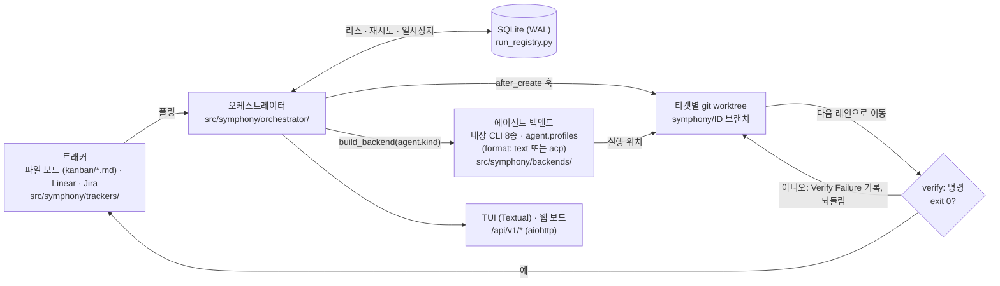

# oh-my-symphony

**[English](README.md) | 한국어**

[](LICENSE)
[](https://www.python.org/)
[](https://github.com/cskwork/oh-my-symphony/actions/workflows/tests.yml)

Symphony는 칸반 보드의 티켓을 AI 코딩 에이전트가 처리할 작업 큐로 바꿉니다.
티켓마다 별도의 `git worktree`에서 원하는 에이전트(Codex, Claude Code, Gemini,
AGY/Antigravity, Kiro, OpenCode, Pi, Prime Agent, 또는 Agent Client Protocol을
쓰는 아무 에이전트)가 실행되며, 진행 상황은 터미널 TUI나 로컬 웹 보드에서
확인합니다. 티켓은 기본적으로 저장소 안의 Markdown 파일이며 Linear와 Jira도 지원합니다.


[OpenAI의 Symphony 레퍼런스 구현](https://github.com/openai/symphony)을 포크했습니다.
전체 설명: **[docs/reference.md](docs/reference.md)**(영문). 사이트:
**[cskwork.github.io/oh-my-symphony](https://cskwork.github.io/oh-my-symphony/)**.

## 왜 필요한가

코딩 에이전트 여러 개를 동시에 돌리면 보통 터미널이 여러 개 생기고, 에이전트들이
같은 체크아웃을 수정하며, 누가 무엇을 하는지 기록이 남지 않습니다. Symphony는
티켓마다 브랜치와 worktree를 따로 주고, 선택한 에이전트 CLI에 맡기며, 실행 상태를
로컬 DB에 보관해 재시작해도 같은 티켓을 두 번 시작하지 않고, 레인 완료 여부를
에이전트가 아닌 사용자 스크립트가 판정하게 할 수 있습니다.

## 동작 방식



**핵심 결정**

- **팩토리 하나, 에이전트 여럿.** [`src/symphony/backends/__init__.py`](src/symphony/backends/__init__.py)의
  `build_backend`가 `agent.kind`로 어댑터를 고릅니다. `agent.profiles`로 일반
  텍스트 CLI(`format: text`)나 ACP 에이전트(`format: acp`)를 Python 없이 추가합니다.
- **컨테이너가 아닌 git worktree로 격리.** [`scripts/symphony-setup-worktree.sh`](scripts/symphony-setup-worktree.sh)가
  각 워크스페이스를 `symphony/<ID>` 브랜치에 붙입니다.
- **완료는 스크립트가 판정.** 티켓이 레인을 떠날 때 `verify:` 명령이 실행되고,
  0이 아니면 되돌립니다([`workflow/verify.py`](src/symphony/workflow/verify.py)).
- **지속되는 실행 리스.** [`run_registry.py`](src/symphony/orchestrator/run_registry.py)가
  SQLite(WAL) 리스와 재시도·일시정지·예산 플래그를 재시작 후에도 유지합니다.
- **작은 코어, 선택 구성요소.** PM Workspace, 운영자 채팅, 앱 릴리스 계약은
  [`packages/`](packages/) 아래 별도 배포본입니다.

모듈 지도: [docs/architecture.md](docs/architecture.md). 결정 기록: [docs/adr/](docs/adr/).

## 설치

Python 3.12 이상과 Git이 필요합니다. PyPI에는 없으므로 GitHub나 체크아웃에서
설치합니다.

```bash
uv tool install git+https://github.com/cskwork/oh-my-symphony   # 도구로 설치
# 또는 체크아웃에서
git clone https://github.com/cskwork/oh-my-symphony.git && cd oh-my-symphony
python3 -m venv .venv && source .venv/bin/activate
python -m pip install -e .
```

**선택 구성요소**는 체크아웃에서 코어 옆에 설치합니다.

| 패키지 | 추가 기능 | 설치 |
|--------|-----------|------|
| `packages/pm` | PM Workspace, `symphony pm` | `python -m pip install ./packages/pm` |
| `packages/chat` | 웹 운영자 채팅과 intent 카드 | `python -m pip install ./packages/chat` |
| `packages/release` | 앱 릴리스 계약, `symphony release` | `python -m pip install ./packages/release` |

`uv tool`이라면 `uv tool install . --with ./packages/pm`(패키지마다 `--with`
하나)을 실행합니다. 패키지가 없으면 해당 명령은 설치 안내를 출력하고 2로 종료합니다.

그다음 [에이전트 CLI](docs/reference.md#install-and-agent-clis)를 하나 이상
`$PATH`에 둡니다: `codex`, `claude`, `gemini`, `agy`, `kiro-cli`, `opencode`, `pi`, `prime-agent`.

## 5분 빠른 시작

**`oh-my-symphony` 체크아웃 안에서 티켓을 실행하지 마세요.** doctor와 시작
과정은 Symphony 자체 저장소의 `WORKFLOW.md`를 거부합니다.

**1. 프로젝트를 만듭니다.** `WORKFLOW.md`, `AGENTS.md`, `kanban/.gitkeep` 세
파일을 커밋합니다. editable 설치에서는 기본 경로가 현재 디렉터리가 아니라
체크아웃 옆입니다.

```bash
symphony project create "My App"      # ./my-app; 경로 지정은 --path DIR
cd my-app
# 또는 기존 디렉터리 등록: symphony project add /path/to/dir --name "My App"
```

생성된 `WORKFLOW.md`는 약 20줄입니다. `defaults: standard`가 네 레인, 프롬프트,
worktree 훅, 에이전트별 명령 블록을 패키지 기본값으로 채우고, 직접 쓴 키가
우선합니다. `server.port`는 9999부터 비어 있는 레지스트리 포트입니다.

```yaml
---
defaults: standard
tracker:
  kind: file
  board_root: ./kanban
workspace:
  root: ~/symphony_workspaces/my-app
  reuse_policy: refresh
agent:
  kind: codex
  auto_merge_push_target: false
server:
  host: 127.0.0.1
  port: 9999
---

You are working on {{ issue.identifier }}: {{ issue.title }}.
```

**2. 에이전트와 완료 검사를 고릅니다.** `agent.kind`를 설정하고(예: `claude`),
필요하면 떠나는 레인을 키로 하는 `verify:` 블록을 추가합니다.

```yaml
verify:
  commands:
    "In Progress": python -m pytest -q
```

Claude 워커는 `--permission-mode acceptEdits`로 실행되므로 프로젝트가 허용하지
않으면 셸 명령이 거부됩니다. `.claude/settings.json`을 추가하고 커밋하세요(워커는
커밋된 트리의 worktree에서 실행됩니다).

```json
{"permissions": {"allow": ["Bash(python -m pytest:*)", "Bash(git merge-tree:*)"]}}
```

**3. 설정을 점검합니다.** `symphony doctor ./WORKFLOW.md`를 실행합니다
(`--run-verify`를 붙이면 verify 명령을 한 번씩 실행). 종료 코드 `0`은 FAIL 없음,
`1`은 FAIL 있음, `2`는 `WORKFLOW.md`를 불러오지 못함입니다. Claude에 Bash 허용
규칙이 없으면 doctor가 WARN을 냅니다.

**4. 티켓을 추가하고 실행합니다.**

```bash
symphony board new TASK-1 "Fix flaky pagination test" \
  --priority 2 --description "tests/test_pagination.py is flaky on CI."
symphony tui ./WORKFLOW.md             # 대화형 터미널
symphony service start ./WORKFLOW.md   # 또는 백그라운드 서비스; 보드 URL을 엽니다
```

폴링 한 번(30초) 안에 카드에 턴 수와 토큰이 붙은 초록 ●가 나타납니다. 에이전트가
`kanban/TASK-1.md`를 수정해 카드를 옮기고, verify 명령이 실패하면
`## Verify Failure`를 덧붙여 되돌립니다. 막힌 티켓은 `.symphony/needs.json`에
나열되고, `symphony board show TASK-1`이 이유를 출력합니다.

> **각 티켓 워크스페이스는 `symphony/<ID>` 브랜치의 `git worktree`입니다.**
> `agent.auto_merge_on_done`을 켜면 오케스트레이터가 Done에서 한 번 병합하므로
> 그 브랜치를 손으로 또 병합하지 마세요.

**프롬프트나 훅을 고치려면** `symphony eject prompts|hooks|all`을 씁니다. 패키지
기본값을 프로젝트에 복사하고 `WORKFLOW.md`가 그 파일을 가리키게 합니다(덮어쓰지
않음). **에이전트 CLI가 없나요?** [mock 백엔드](docs/reference.md#mock-demo-no-agent-cli-required)는
LLM 없이 턴과 토큰을 보여 주지만 카드는 움직이지 않습니다.

## 명령

| 명령 | 하는 일 |
|------|---------|
| `symphony project create\|add\|list\|start\|stop\|status\|remove` | 프로젝트 서비스 등록·실행 (`--with-skill`은 운영자 skill 복사) |
| `symphony hub` | 멀티 프로젝트 허브 (기본 `127.0.0.1:8787`) |
| `symphony doctor [WORKFLOW] [--run-verify]` | `WORKFLOW.md` 사전 점검 |
| `symphony eject [prompts\|hooks\|all] [WORKFLOW]` | 기본 프롬프트·훅을 프로젝트로 복사해 편집 |
| `symphony board init\|ls\|new\|mv\|update\|show\|graph` | 검증되는 파일 보드 티켓 도구 |
| `symphony tui [WORKFLOW]` | 오케스트레이터 + 터미널 칸반 TUI |
| `symphony [WORKFLOW]` | 헤드리스 오케스트레이터, 웹 보드와 `WORKFLOW-PROGRESS.md` 포함 |
| `symphony service start\|stop\|restart\|status\|logs` | 관리형 백그라운드 오케스트레이터 |
| `symphony runs [WORKFLOW]` | 최근 실행 시도 |
| `symphony factory init\|sync\|start` | 자율 개발 팩토리 |
| `symphony pm demo` | PM Workspace 데모 (`packages/pm` 필요) |
| `symphony release check` | 앱 릴리스 증거 검증 (`packages/release` 필요) |

## 0.29의 새 기능

- `project create`가 파일 3개를 쓰고, 빈 포트를 고르며, `uv tool install`에서도 동작.
- `defaults: standard`, `symphony eject`, `verify:` 게이트(완료는 스크립트가 판정).
- `.symphony/needs.json`, `symphony doctor --run-verify`, ACP 에이전트 프로필.
- PM, 채팅, 릴리스가 선택 패키지로 분리; 코어 wheel 3.0 MB → 1.2 MB.

자세한 내용과 업그레이드 절차: [CHANGELOG.md](CHANGELOG.md#0290---2026-10-28---lean-and-easy).

## 기능

티켓별·레인별·장애 조치 [에이전트 라우팅](docs/reference.md#agent-backends);
파일·Linear·Jira 트래커; 웹 보드와 TUI(보드를 외부에 노출하기 전에
[Reverse proxy, tunnels, and API token](docs/reference.md#reverse-proxy-tunnels-and-api-token)을 읽으세요);
`default`와 `deep` [레인 프리셋](docs/PIPELINE.md); 자율 개발 팩토리
(`symphony factory init|start`). Superdesign 브라우저 게이트에는 Node.js 18+,
`@playwright/cli`(`npm install -g @playwright/cli@latest`), `playwright-cli install --skills`가
필요합니다. [팩토리 가이드](src/symphony/templates/project/skills/symphony-skill/reference/factory.md)를 참고하세요.

## 문서

[레퍼런스](docs/reference.md)(설정, 명령, API, 주의사항),
[아키텍처](docs/architecture.md), [v1.0 계획과 현황](docs/prd/v1.0-lean-core.md),
[운영자 skill](src/symphony/templates/project/skills/symphony-skill/),
[CHANGELOG.md](CHANGELOG.md).

## 기여

PR은 `dev`를 대상으로 합니다. [CONTRIBUTING.md](CONTRIBUTING.md)에 설치(코어와
세 패키지, `npm ci --prefix packages/pm`)와 필수 검사(`python -m pytest -q`,
`ruff`, `symphony-pyright`)가 있습니다.

## 테스트

마지막 로컬 관측(2026-10-28, macOS, Python 3.12):

| 명령 | 통과 | 실패 | 건너뜀 |
|---|---|---|---|
| `python -m pytest -q -n auto -m "not timing"` | 3925 | 6 | 136 |
| `python -m pytest -q -n0 -m timing` | 11 | 0 | 1 |

전체 실행은 기계 부하가 큰 상태였습니다. 실패 6건 중 4건은 직렬로 다시 돌리면
통과합니다. 나머지 2건(`test_workspace` 훅 출력 테스트)은 이 기계의 로그인 셸이
Kiro 배너를 출력해서 v0.28.0 기준선에서도 실패합니다. CI 결과는 릴리스 PR에
기록합니다.

## 제한 사항

- 아직 PyPI에 없습니다. GitHub나 체크아웃에서 설치하며, 선택 패키지도
  체크아웃에서 설치합니다.
- Windows는 Git Bash가 필요하고, 일부 수명 주기 동작은 Windows CI 작업으로만
  검증됩니다. ACP 에이전트는 Windows에서 검증되지 않았습니다.
- Linear·Jira 보드는 브라우저에서 읽기 전용이고, 브라우저 E2E 테스트는
  선택 실행입니다(`SYMPHONY_BROWSER_E2E=1`).

## 라이선스

[Apache 2.0](LICENSE). OpenAI의 [Symphony](https://github.com/openai/symphony)를
기반으로 합니다. [NOTICE](NOTICE)를 참고하세요. TUI는
[Textual](https://textual.textualize.io)을 사용합니다.
