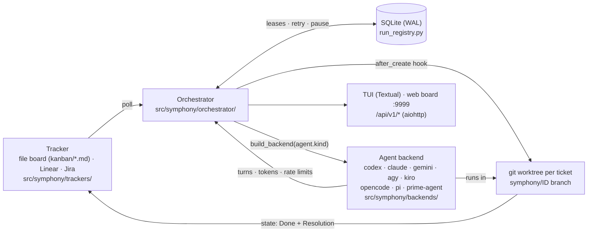

# oh-my-symphony

**English | [한국어](README.ko.md)**

[](LICENSE)
[](https://www.python.org/)
[](https://github.com/cskwork/oh-my-symphony/actions/workflows/tests.yml)

Symphony turns a Kanban board into a queue of work for AI coding agents. Each
ticket runs in its own `git worktree` with the agent you pick (Codex, Claude
Code, Gemini, AGY/Antigravity, Kiro, OpenCode, Pi, or Prime Agent), and you
watch progress in a terminal TUI or a local web board on port 9999. Tickets
are Markdown files in your repo by default; Linear and Jira also work.


Forked from [OpenAI's Symphony reference implementation](https://github.com/openai/symphony).
Full details: **[docs/reference.md](docs/reference.md)**. Live site:
**[cskwork.github.io/oh-my-symphony](https://cskwork.github.io/oh-my-symphony/)**.

## Why

Running several coding agents at once usually means several terminals, agents
editing the same checkout, and no record of who is working on what. Symphony
gives each ticket its own branch and worktree, dispatches it to the agent CLI
you chose, and keeps the run state (leases, retries, pauses) in a local
database so a restart does not start the same ticket twice.

## How it works



Module map, invariants, and test seams: [docs/architecture.md](docs/architecture.md).

**Key decisions**

- **One factory, many agents.** `build_backend` in
  [`src/symphony/backends/__init__.py`](src/symphony/backends/__init__.py)
  picks the adapter from `agent.kind`; a ticket's `agent_kind` frontmatter or
  `agent.stage_kinds` overrides it, and `agent.profiles` adds a plain CLI
  without code.
- **Isolation by git worktree, not containers.** The `after_create` hook runs
  [`scripts/symphony-setup-worktree.sh`](scripts/symphony-setup-worktree.sh)
  to attach each workspace on a `symphony/<ID>` branch, so the host checkout
  stays untouched.
- **Durable run leases.** `RunRegistry.acquire_run` in
  [`src/symphony/orchestrator/run_registry.py`](src/symphony/orchestrator/run_registry.py)
  must own a SQLite (WAL) lease before a worker starts; dead owners are
  reclaimed, and retry/pause/budget flags survive restarts.
- **Files as the default tracker.** Tickets are Markdown in `kanban/`; writes
  go through a lock and compare-and-swap path in
  [`src/symphony/trackers/file.py`](src/symphony/trackers/file.py), so no SaaS
  or API key is needed to start.
- **Cheap health.** `/api/v1/health` reads counters only, so `symphony service`
  can probe it even when tracker refresh is degraded
  ([`src/symphony/server.py`](src/symphony/server.py)).

Recorded decisions: [docs/adr/](docs/adr/) (immutable project runtimes,
machine-enforced release contracts, bounded run diagnostics, crash
continuation, opt-in DAG scheduling, lean core).

## Install

Requires Python 3.12+ and Git. Symphony is not on PyPI yet; install from this
checkout:

```bash
git clone https://github.com/cskwork/oh-my-symphony.git
cd oh-my-symphony
python3 -m venv .venv && source .venv/bin/activate
python -m pip install -e .
```

Then put at least one agent CLI on `$PATH`:

| `agent.kind` | CLI | Install / sign-in |
|--------------|-----|-------------------|
| `codex` | `codex` | needs the `app-server` subcommand |
| `claude` | `claude` | Claude Code |
| `gemini` | `gemini` | Gemini CLI |
| `agy` | `agy` | Google Antigravity |
| `kiro` | `kiro-cli` | `kiro-cli login` or `KIRO_API_KEY` |
| `opencode` | `opencode` | `npm install -g opencode-ai`, `opencode auth login` |
| `pi` | `pi` | `npm i -g @earendil-works/pi-coding-agent`, then `/login` |
| `prime-agent` | `prime-agent` | Prime Agent installer, then `/login` or a provider API key |

Exact install commands are in the [reference](docs/reference.md#install-and-agent-clis).

## 5-minute quickstart

**Do not run tickets inside the `oh-my-symphony` checkout.** Doctor and
startup refuse a `WORKFLOW.md` in Symphony's own repository so agents cannot
edit the orchestrator. Create or register a separate project instead.

**1. Create or register a project.** This writes `WORKFLOW.md`, a `kanban/`
board, stage prompts, skills, and `AGENTS.md`.

```bash
symphony project create "My App" --path ../my-app
# or adopt an existing directory (Git and missing files are added safely)
symphony project add /path/to/existing-project --name "My App"
cd ../my-app
```

For a bare directory with your own `WORKFLOW.md`, run `symphony board init ./kanban`.

**2. Pick the agent.** Set `agent.kind` in `WORKFLOW.md`, for example
`kind: claude`.

**3. Check the setup.**

```bash
symphony doctor ./WORKFLOW.md      # every line should read PASS
```

Exit code `0` means all checks passed, `1` means a FAIL, `2` means
`WORKFLOW.md` could not be loaded.

**4. Add a ticket.**

```bash
symphony board new TASK-1 "Fix flaky pagination test" \
  --priority 2 --description "tests/test_pagination.py is flaky on CI."
```

**5. Run it.** Use the terminal TUI or the web board:

```bash
symphony tui ./WORKFLOW.md                        # needs an interactive terminal
symphony service start ./WORKFLOW.md --port 9999  # background service
# open http://127.0.0.1:9999/
```

Within one poll tick (30 s by default) the card shows a green ● with turn
count and tokens. When the agent finishes, it sets `state: Done` in
`kanban/TASK-1.md` and appends a `## Resolution` section; that edit moves the
card. If the port is busy, `symphony tui` reports which process holds it.

> **The default hook attaches each ticket workspace as a `git worktree` on a
> `symphony/<ID>` branch.** With `agent.auto_merge_on_done` enabled the
> orchestrator merges once at Done; do not merge that branch by hand as well.

**No agent CLI yet?** The bundled mock backend moves cards without calling an
LLM. See [Mock demo](docs/reference.md#mock-demo-no-agent-cli-required).

## Commands

| Command | What it does |
|---------|--------------|
| `symphony project create\|add\|list\|start\|stop\|status\|remove` | Register and run independent project services |
| `symphony hub` | Multi-project hub (default `127.0.0.1:8787`) |
| `symphony doctor [WORKFLOW]` | Preflight checks for `WORKFLOW.md` |
| `symphony board init\|ls\|new\|mv\|update\|show\|graph` | Validated file-board ticket tool |
| `symphony tui [WORKFLOW]` | Orchestrator + terminal Kanban TUI |
| `symphony [WORKFLOW]` | Orchestrator headless, with web board and `WORKFLOW-PROGRESS.md` |
| `symphony service start\|stop\|restart\|status\|logs` | Managed background orchestrator |
| `symphony runs [WORKFLOW]` | Recent run attempts |
| `symphony factory init\|sync\|start` | Autonomous development factory |
| `symphony pm demo` | Disposable PM Workspace demo |
| `symphony release check` | Validate app release evidence |

Useful flags: `--port`, `--host`, `--tui`, `--no-progress-md`,
`--no-keep-awake`, `--log-level`. Logs go to stderr only; redirect with
`2>> log/symphony.log`.

## Features

**Agent backends.** Set a global `agent.kind`, pin one per ticket with
`agent_kind: codex` in ticket frontmatter (or `board new --agent-kind`), route
per lane with `agent.stage_kinds`, and fail over with `agent.fallback_kinds`.
See [Agent backends](docs/reference.md#agent-backends).

**Trackers.** File board by default (`tracker.kind: file`). Linear:
[`WORKFLOW.example.md`](WORKFLOW.example.md). Jira:
[`examples/WORKFLOW.jira.example.md`](examples/WORKFLOW.jira.example.md).
Browser editing is file-board only; Linear/Jira boards are read-only status.
See [Trackers](docs/reference.md#trackers-file-linear-jira).

**Web board and TUI.** Projects, board CRUD and drag-and-drop, workflow and
prompt editing, Git review and merge, operator chat, product preview, runs,
stats, and settings at `http://127.0.0.1:9999/`. The TUI covers ticket
create/edit, pause/resume, skip Document, filter, and stats (`?` lists keys).
Before exposing the board through a proxy or tunnel, read
[Reverse proxy, tunnels, and API token](docs/reference.md#reverse-proxy-tunnels-and-api-token).

**Autonomous development factory.** A Wayfinder -> Symphony -> Supergoal loop
with a `Ready -> Build -> Verify -> Done` board:

```bash
git init my-product && cd my-product
symphony factory init . --agent opencode
git add . && git commit -m "Initialize Symphony factory"
# create Wayfinder tickets under wayfinder/tickets/, then:
symphony factory start ./wayfinder
```

Superdesign browser gates need Node.js 18+, `@playwright/cli`
(`npm install -g @playwright/cli@latest`), and `playwright-cli install --skills`. See
[Autonomous development factory](docs/reference.md#autonomous-development-factory)
and the [factory guide](skills/symphony-skill/reference/factory.md).

**PM Workspace.** Plan a change (idea, requirements, design, plan) and hand
it off as board tickets. Try `symphony pm demo` (or `--lang ko`); it needs Git
and Node.js 20.19.0+. See [docs/pm-workspace.md](docs/pm-workspace.md).

**Lane presets.** `default` (Todo, In Progress, Verify, Document) or `deep`
(eight lanes from Intake to Document), switchable in Settings. See
[Lane presets](docs/reference.md#lane-presets-and-stage-contracts) and
[docs/PIPELINE.md](docs/PIPELINE.md).

**Also included:** chat intake with one approval gate, opt-in app release
contracts, experimental continuous improvement, Slack notifications, English
and Korean UI (`tui.language` / `SYMPHONY_LANG`), and macOS keep-awake.
Windows needs Git Bash; see [Platforms](docs/reference.md#platforms).

## Documentation

- [docs/reference.md](docs/reference.md): configuration, commands, API, and caveats
- [docs/architecture.md](docs/architecture.md): how the orchestrator works
- [docs/PIPELINE.md](docs/PIPELINE.md) and [docs/PIPELINE-DEMO.md](docs/PIPELINE-DEMO.md): stage contracts
- [docs/pm-workspace.md](docs/pm-workspace.md) and [operations](docs/pm-workspace-operations.md)
- [docs/adr/](docs/adr/): architecture decisions
- [docs/prd/v1.0-lean-core.md](docs/prd/v1.0-lean-core.md): v1.0 plan (reduce bloat, keep shipped features)
- [skills/symphony-skill/](skills/symphony-skill/): agent skill and operator guides
- [CHANGELOG.md](CHANGELOG.md): release history

## Contributing

PRs target `dev`. See [CONTRIBUTING.md](CONTRIBUTING.md).

```bash
python -m pip install -e ".[dev]"
python -m pytest -q
python -m ruff check src tests
symphony-pyright
```

## Testing

Results: pending CI on this branch.

CI ([`.github/workflows/tests.yml`](.github/workflows/tests.yml)) runs ruff,
the i18n check, pyright, and the suite with an 80% coverage floor on Ubuntu,
plus a native Windows lifecycle job.

## Limitations

- Not on PyPI yet; install from a checkout.
- Windows needs Git Bash; some lifecycle behavior is only verified by the
  Windows CI job.
- Linear and Jira boards are read-only in the browser; editing is file-board
  only.
- Browser end-to-end tests are opt-in (`SYMPHONY_BROWSER_E2E=1` plus
  Playwright browsers) and are not part of the default run.

## License

[Apache 2.0](LICENSE). Built on OpenAI's
[Symphony](https://github.com/openai/symphony); see [NOTICE](NOTICE). The TUI
uses [Textual](https://textual.textualize.io).
