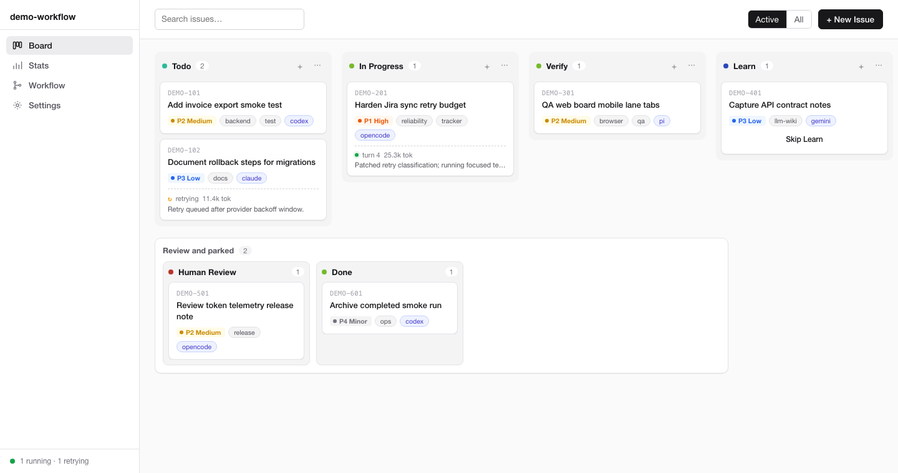
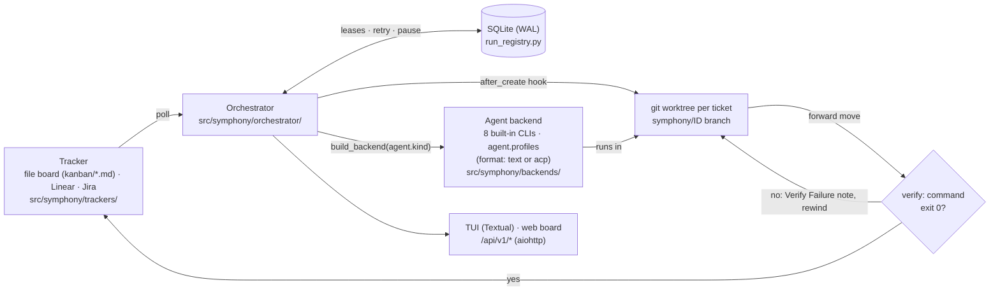

# oh-my-symphony

**English | [한국어](README.ko.md)**

[](LICENSE)
[](https://www.python.org/)
[](https://github.com/cskwork/oh-my-symphony/actions/workflows/tests.yml)

Symphony turns a Kanban board into a queue of work for AI coding agents. Each
ticket runs in its own `git worktree` with the agent you pick (Codex, Claude
Code, Gemini, AGY/Antigravity, Kiro, OpenCode, Pi, Prime Agent, or any Agent
Client Protocol agent), and you watch progress in a terminal TUI or a local web
board. Tickets are Markdown files in your repo by default; Linear and Jira also
work.



Forked from [OpenAI's Symphony reference implementation](https://github.com/openai/symphony).
Full details: **[docs/reference.md](docs/reference.md)**. Live site:
**[cskwork.github.io/oh-my-symphony](https://cskwork.github.io/oh-my-symphony/)**.

## Why

Running several coding agents at once usually means several terminals, agents
editing the same checkout, and no record of who is working on what. Symphony
gives each ticket its own branch and worktree, dispatches it to your agent CLI,
keeps run state in a local database so a restart does not start the same
ticket twice, and can let your scripts, not the agent, decide when a lane is done.

## How it works



**Key decisions**

- **One factory, many agents.** `build_backend` in
  [`src/symphony/backends/__init__.py`](src/symphony/backends/__init__.py)
  picks the adapter from `agent.kind`; `agent.profiles` adds a plain-text CLI
  (`format: text`) or an ACP agent (`format: acp`) with no Python.
- **Isolation by git worktree, not containers.** [`scripts/symphony-setup-worktree.sh`](scripts/symphony-setup-worktree.sh)
  attaches each workspace on a `symphony/<ID>` branch.
- **Scripts decide done.** A `verify:` command runs when a ticket leaves a lane;
  non-zero rewinds it ([`workflow/verify.py`](src/symphony/workflow/verify.py)).
- **Durable run leases.** [`run_registry.py`](src/symphony/orchestrator/run_registry.py)
  holds SQLite (WAL) leases and retry, pause, and budget flags across restarts.
- **Small core, optional extras.** PM Workspace, operator chat, and app release
  contracts are separate distributions under [`packages/`](packages/).

Module map: [docs/architecture.md](docs/architecture.md). Decisions: [docs/adr/](docs/adr/).

## Install

Requires Python 3.12+ and Git. Symphony is not on PyPI; install from GitHub or
a checkout.

```bash
uv tool install git+https://github.com/cskwork/oh-my-symphony   # as a tool
# or from a checkout
git clone https://github.com/cskwork/oh-my-symphony.git && cd oh-my-symphony
python3 -m venv .venv && source .venv/bin/activate
python -m pip install -e .
```

**Optional components** install from a checkout, next to core:

| Package | Adds | Install |
|---------|------|---------|
| `packages/pm` | PM Workspace, `symphony pm` | `python -m pip install ./packages/pm` |
| `packages/chat` | web operator chat and intent cards | `python -m pip install ./packages/chat` |
| `packages/release` | app release contracts, `symphony release` | `python -m pip install ./packages/release` |

With `uv tool`, run `uv tool install . --with ./packages/pm` (one `--with` per
package). Without a package, its command prints an install hint and exits 2.

Then put at least one [agent CLI](docs/reference.md#install-and-agent-clis) on
`$PATH`: `codex`, `claude`, `gemini`, `agy`, `kiro-cli`, `opencode`, `pi`, `prime-agent`.

## 5-minute quickstart

**Do not run tickets inside the `oh-my-symphony` checkout.** Doctor and startup
refuse a `WORKFLOW.md` in Symphony's own repository.

**1. Create a project.** This commits three files: `WORKFLOW.md`, `AGENTS.md`,
and `kanban/.gitkeep`. From an editable install the default path is next to
the checkout instead of the current directory.

```bash
symphony project create "My App"      # ./my-app; --path DIR to choose
cd my-app
# or adopt an existing directory: symphony project add /path/to/dir --name "My App"
```

The generated `WORKFLOW.md` is about 20 lines. `defaults: standard` fills the
four lanes, prompts, worktree hooks, and per-agent command blocks from the
package; any key you write wins. `server.port` is the next free registry port
from 9999.

```yaml
---
defaults: standard
tracker:
  kind: file
  board_root: ./kanban
workspace:
  root: ~/symphony_workspaces/my-app
  reuse_policy: refresh
agent:
  kind: codex
  auto_merge_push_target: false
server:
  host: 127.0.0.1
  port: 9999
---

You are working on {{ issue.identifier }}: {{ issue.title }}.
```

**2. Pick the agent and the done check.** Set `agent.kind` (for example
`claude`), and optionally add a `verify:` block keyed by the lane being left:

```yaml
verify:
  commands:
    "In Progress": python -m pytest -q
```

Claude workers run with `--permission-mode acceptEdits`, which denies shell
commands unless the project allows them. Add and commit `.claude/settings.json`
(workers run in worktrees of the committed tree):

```json
{"permissions": {"allow": ["Bash(python -m pytest:*)", "Bash(git merge-tree:*)"]}}
```

**3. Check the setup** with `symphony doctor ./WORKFLOW.md` (add
`--run-verify` to run each verify command once). Exit code `0` means no FAIL,
`1` a FAIL, `2` an unloadable `WORKFLOW.md`; a missing Claude Bash rule WARNs.

**4. Add a ticket and run it.**

```bash
symphony board new TASK-1 "Fix flaky pagination test" \
  --priority 2 --description "tests/test_pagination.py is flaky on CI."
symphony tui ./WORKFLOW.md             # interactive terminal
symphony service start ./WORKFLOW.md   # or a background service; open the board URL
```

Within one poll tick (30 s) the card shows a green ● with turns and tokens. The
agent moves the card by editing `kanban/TASK-1.md`; a failed verify command
appends `## Verify Failure` and rewinds it. Stuck tickets are listed in
`.symphony/needs.json`; `symphony board show TASK-1` prints why.

> **Each ticket workspace is a `git worktree` on a `symphony/<ID>` branch.**
> With `agent.auto_merge_on_done` enabled the orchestrator merges once at Done;
> do not merge that branch by hand as well.

**Customize prompts or hooks** with `symphony eject prompts|hooks|all`: it copies
the package defaults into the project and points `WORKFLOW.md` at them (never
overwrites). **No agent CLI?** The [mock backend](docs/reference.md#mock-demo-no-agent-cli-required)
shows turns and tokens without an LLM, but cards do not move.

## Commands

| Command | What it does |
|---------|--------------|
| `symphony project create\|add\|list\|start\|stop\|status\|remove` | Register and run project services (`--with-skill` copies the operator skill) |
| `symphony hub` | Multi-project hub (default `127.0.0.1:8787`) |
| `symphony doctor [WORKFLOW] [--run-verify]` | Preflight checks for `WORKFLOW.md` |
| `symphony eject [prompts\|hooks\|all] [WORKFLOW]` | Copy default prompts/hooks into the project for editing |
| `symphony board init\|ls\|new\|mv\|update\|show\|graph` | Validated file-board ticket tool |
| `symphony tui [WORKFLOW]` | Orchestrator + terminal Kanban TUI |
| `symphony [WORKFLOW]` | Orchestrator headless, with web board and `WORKFLOW-PROGRESS.md` |
| `symphony service start\|stop\|restart\|status\|logs` | Managed background orchestrator |
| `symphony runs [WORKFLOW]` | Recent run attempts |
| `symphony factory init\|sync\|start` | Autonomous development factory |
| `symphony pm demo` | PM Workspace demo (needs `packages/pm`) |
| `symphony release check` | Validate app release evidence (needs `packages/release`) |

## What's new in 0.29

- `project create` writes 3 files, picks a free port, works from `uv tool install`.
- `defaults: standard`, `symphony eject`, and `verify:` gates (scripts decide done).
- `.symphony/needs.json`, `symphony doctor --run-verify`, and ACP agent profiles.
- PM, chat, and release are optional packages; core wheel 3.0 MB → 1.2 MB.

Details and upgrade steps: [CHANGELOG.md](CHANGELOG.md#0290---2026-10-28---lean-and-easy).

## Features

Per-ticket, per-lane, and failover [agent routing](docs/reference.md#agent-backends);
file, Linear, and Jira trackers; web board and TUI (read
[Reverse proxy, tunnels, and API token](docs/reference.md#reverse-proxy-tunnels-and-api-token)
before exposing the board); `default` and `deep` [lane presets](docs/PIPELINE.md);
and the autonomous development factory (`symphony factory init|start`).
Superdesign browser gates need Node.js 18+, `@playwright/cli`
(`npm install -g @playwright/cli@latest`), and `playwright-cli install --skills`;
see the [factory guide](src/symphony/templates/project/skills/symphony-skill/reference/factory.md).

## Documentation

[Reference](docs/reference.md) (configuration, commands, API, caveats),
[architecture](docs/architecture.md), [v1.0 plan and status](docs/prd/v1.0-lean-core.md),
[operator skill](src/symphony/templates/project/skills/symphony-skill/), and
[CHANGELOG.md](CHANGELOG.md).

## Contributing

PRs target `dev`. [CONTRIBUTING.md](CONTRIBUTING.md) has the setup (core plus
the three packages, `npm ci --prefix packages/pm`) and the required checks
(`python -m pytest -q`, `ruff`, `symphony-pyright`).

## Testing

Last observed locally (2026-10-28, macOS, Python 3.12):

| Command | Passed | Failed | Skipped |
|---|---|---|---|
| `python -m pytest -q -n auto -m "not timing"` | 3925 | 6 | 136 |
| `python -m pytest -q -n0 -m timing` | 11 | 0 | 1 |

The full run was under heavy machine load: 4 of the 6 failures pass when rerun
serially. The other 2 (`test_workspace` hook-output tests) also fail on the
v0.28.0 baseline on this machine because the login shell prints a Kiro banner.
CI results will be recorded on the release PR.

## Limitations

- Not on PyPI yet; install from GitHub or a checkout. The optional packages
  also install from the checkout.
- Windows needs Git Bash; some lifecycle behavior is only verified by the
  Windows CI job. ACP agents are not verified on Windows.
- Linear and Jira boards are read-only in the browser; browser E2E tests are
  opt-in (`SYMPHONY_BROWSER_E2E=1`).

## License

[Apache 2.0](LICENSE). Built on OpenAI's
[Symphony](https://github.com/openai/symphony); see [NOTICE](NOTICE). The TUI
uses [Textual](https://textual.textualize.io).
