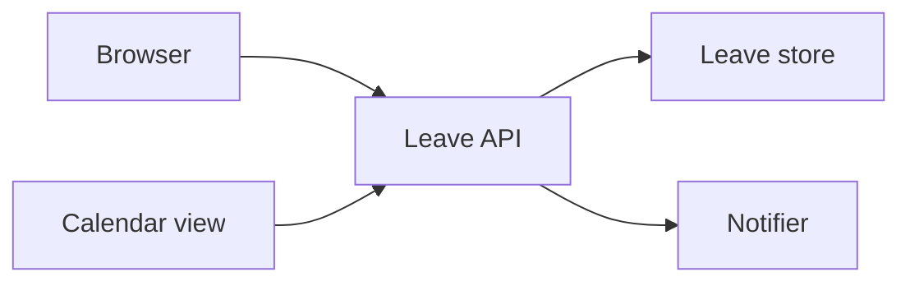
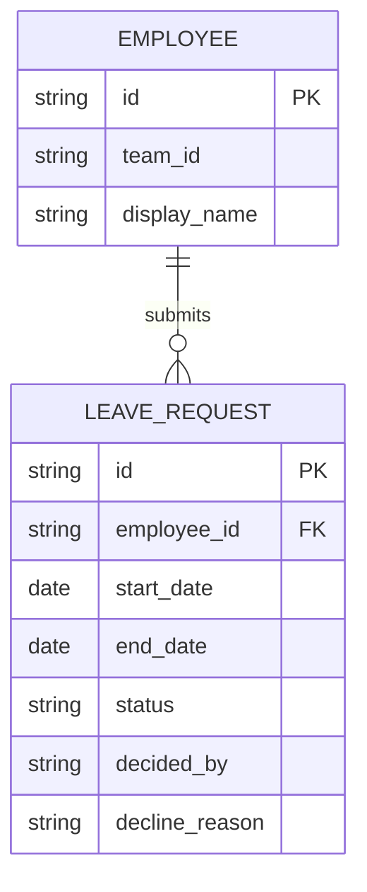

# Leave request design

## Architecture and ownership
The browser handles the form and inbox. The Leave API checks employee identity, team access, dates, and request status. The Leave store persists requests. The Notifier delivers approval messages; the calendar reads approved leave through the same API.

## Data model and migration
EMPLOYEE identifies the requester and their team. LEAVE_REQUEST records inclusive dates, status, deciding manager, and an optional decline reason. Add request storage; do not alter employee membership or calculate leave balances.

## API and integration contracts

### Contract: Submit leave request
<!-- symphony:contract={{ID:submit_leave}} -->
- Owner/boundary: Backend owns POST /api/leave-requests; the request form sends start_date, end_date, and a client request key (request_key).
- Auth/schema/errors/version/idempotency: Existing employee sign-in supplies employee_id and team_id; never trust these from the browser. Dates use YYYY-MM-DD. Return 201 with id, start_date, end_date, and status Pending; 400 for invalid dates, 401 for no sign-in, or 409 for overlap. A client request key deduplicates retries of the same submission; reusing it with different dates returns 409. No existing endpoint changes.
- Retry/partial failure: Check overlap and insert in one transaction, so concurrent overlapping requests cannot both succeed. After a lost response, retry with the same key and return the saved request without creating another.
- Verification: Check valid submission, reversed dates, inclusive boundary overlap, simultaneous overlap, and retry deduplication for {{ID:submit_request}}, {{ID:request_pending}}, {{ID:overlap_refused}}.

### Contract: Decide leave request
<!-- symphony:contract={{ID:decide_leave}} -->
- Owner/boundary: Backend owns POST /api/leave-requests/{id}/decision; the manager inbox sends decision Approved or Declined and reason when declining.
- Auth/schema/errors/version/idempotency: Existing sign-in must identify a manager of the requester's team. Return 200 with id, status, and decline_reason; 400 for an unsupported decision or missing decline reason, 401 for no sign-in, 403 for wrong team, 404 for an unknown request, or 409 for an incompatible prior decision. Repeating the same decision and reason returns the saved result without a second notification. The team calendar reads through the same Leave API and includes only Approved requests for the signed-in user's team and selected month.
- Retry/partial failure: Save the decision and a durable approval notification record together. Retry notification delivery without undoing Approved status or creating duplicate messages.
- Verification: Check approval notification, decline with and without a reason, wrong-team refusal, competing decisions, retry behavior, and calendar filtering for {{ID:decide_request}}, {{ID:approval_notifies}}, {{ID:decline_reason_required}}, {{ID:approved_calendar}}, {{ID:calendar_approved_only}}.

## Security, concurrency, and operations
Derive team access from sign-in on every request. Serialize conflicting date reservations and decisions in the store. Log request IDs and notification failures without logging private reasons. Pending and Approved reserve dates; Declined releases them.

## Verification and rollback
Run demo-check on API, storage, and calendar behavior. Use demo-review to walk through the form, inbox, and calendar, including errors and keyboard use. If delivery must be rolled back, hide the new screens and stop new writes while retaining recorded requests and decisions for review.
