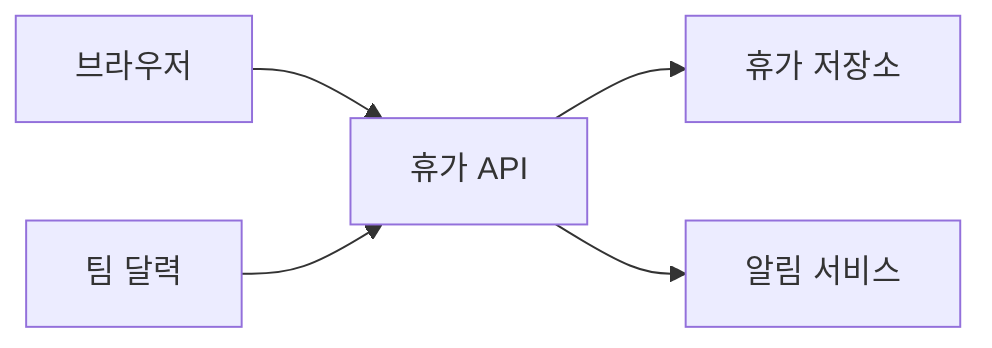
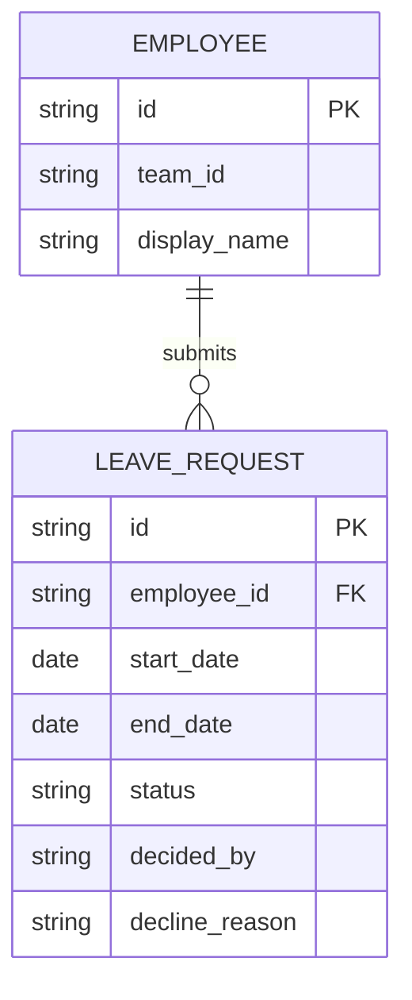

# 휴가 신청 설계

## Architecture and ownership
브라우저는 신청 화면과 검토함을 제공합니다. 휴가 API는 직원 신원, 팀 권한, 날짜, 신청 상태를 확인합니다. 휴가 저장소는 신청을 보관합니다. 알림 서비스는 승인 소식을 전달하고, 달력은 같은 API로 승인된 휴가를 읽습니다.

## Data model and migration
EMPLOYEE는 신청 직원과 소속 팀을 나타냅니다. LEAVE_REQUEST는 시작일과 종료일, 상태, 처리 관리자, 반려한 경우의 반려 사유를 기록합니다. 신청 저장 공간을 추가하되 직원의 팀 소속을 바꾸거나 잔여 휴가 일수를 계산하지 않습니다.

## API and integration contracts

### Contract: 휴가 신청을 접수한다
<!-- symphony:contract={{ID:submit_leave}} -->
- Owner/boundary: 백엔드가 POST /api/leave-requests를 제공합니다. 신청 화면은 시작일(start_date), 종료일(end_date), 재시도 확인용 요청 키(request_key)를 보냅니다.
- Auth/schema/errors/version/idempotency: 직원 ID(employee_id)와 팀 ID(team_id)는 기존 로그인 정보에서 가져오며 브라우저가 보낸 값을 신뢰하지 않습니다. 날짜 형식은 YYYY-MM-DD입니다. 성공하면 201과 id, start_date, end_date, Pending(승인 대기) 상태를 반환합니다. 잘못된 날짜는 400, 로그인하지 않은 경우는 401, 날짜 중복은 409입니다. 같은 신청을 다시 보낼 때는 동일한 요청 키를 사용해 중복 저장을 막고, 같은 키로 다른 날짜를 보내면 409를 반환합니다. 기존 API는 변경하지 않습니다.
- Retry/partial failure: 날짜 중복 확인과 저장을 하나의 처리 단위로 묶어, 동시에 들어온 겹치는 신청 중 하나만 저장되게 합니다. 응답을 받지 못했다면 같은 요청 키로 다시 보내며, 이미 저장한 신청을 반환하고 새로 만들지 않습니다.
- Verification: 정상 신청, 시작일이 종료일보다 늦은 경우, 시작일이나 종료일이 기존 신청과 하루만 겹치는 경우, 동시 신청, 재시도 중복 방지를 확인합니다. 관련 요구사항과 시나리오는 {{ID:submit_request}}, {{ID:request_pending}}, {{ID:overlap_refused}}입니다.

### Contract: 휴가 신청을 승인하거나 반려한다
<!-- symphony:contract={{ID:decide_leave}} -->
- Owner/boundary: 백엔드가 POST /api/leave-requests/{id}/decision을 제공합니다. 관리자 검토함은 처리 결과(decision)로 Approved(승인) 또는 Declined(반려)를 보내고, 반려할 때는 사유(reason)를 함께 보냅니다.
- Auth/schema/errors/version/idempotency: 로그인 정보로 신청 직원과 같은 팀의 관리자인지 확인합니다. 성공하면 200과 id, status, decline_reason을 반환합니다. 지원하지 않는 처리 결과나 반려 사유 누락은 400, 로그인하지 않은 경우는 401, 다른 팀은 403, 없는 신청은 404, 이미 다른 결과로 처리된 신청은 409입니다. 같은 결과와 사유를 다시 보내면 저장된 결과를 반환하고 알림을 다시 만들지 않습니다. 팀 달력도 같은 휴가 API로 조회하며, 로그인한 사용자의 팀과 선택한 달의 Approved(승인) 신청만 포함합니다.
- Retry/partial failure: 처리 결과와 승인 알림 기록을 함께 저장합니다. 알림 전달에 실패하면 다시 시도하되 Approved(승인) 상태를 되돌리거나 같은 알림을 중복 발송하지 않습니다.
- Verification: 승인 알림, 사유가 있는 반려, 사유 없는 반려 거절, 다른 팀의 처리 거절, 동시 처리, 재시도, 달력의 표시 범위를 확인합니다. 관련 요구사항과 시나리오는 {{ID:decide_request}}, {{ID:approval_notifies}}, {{ID:decline_reason_required}}, {{ID:approved_calendar}}, {{ID:calendar_approved_only}}입니다.

## Security, concurrency, and operations
요청마다 로그인 정보로 팀 접근 권한을 확인합니다. 저장소에서 겹치는 날짜 예약과 서로 다른 처리 결과가 충돌하지 않도록 순서대로 처리합니다. 신청 ID와 알림 실패는 기록하되 개인 정보가 담길 수 있는 반려 사유는 로그에 남기지 않습니다. 승인 대기와 승인 상태는 날짜를 예약하고, 반려 상태는 예약을 해제합니다.

## Verification and rollback
API, 저장, 달력 동작은 demo-check로 확인합니다. 신청 화면, 검토함, 달력의 오류 안내와 키보드 사용은 demo-review로 확인합니다. 문제가 생겨 되돌려야 한다면 새 화면을 숨기고 새 저장을 중단하되, 검토할 수 있도록 기존 신청과 처리 기록은 보관합니다.
